# Mini-projet Docker

Application web **Flask** conteneurisée avec **Docker**, configurable par variables d'environnement, versionnée avec Git (GitHub) et publiée sur **Docker Hub**.

- Dépôt Git : https://github.com/hyybaafarhat-bit/mini-projet-docker
- Image Docker Hub : https://hub.docker.com/r/hybafarhat/mini-projet-docker (`hybafarhat/mini-projet-docker`)
- Environnement : Ubuntu Server 26.04 (VMware), Docker 29.10.0, Git 2.53.0

## Contenu du dépôt

| Fichier | Rôle |
|---|---|
| `app.py` | Application Flask (page d'accueil `/` et route `/health`) |
| `requirements.txt` | Dépendances Python (`Flask==3.1.2`) |
| `Dockerfile` | Description de la construction de l'image |
| `.dockerignore` | Fichiers exclus du contexte de build |
| `.gitignore` | Fichiers exclus du dépôt Git |
| `captures/` | Captures d'écran de la démarche |

## Ce que fait l'application

- `GET /` : page HTML qui affiche le nom de l'application et l'environnement.
- `GET /health` : retourne `{"status": "healthy"}`.
- L'application écoute sur `0.0.0.0:5000` pour être joignable depuis l'extérieur du conteneur.

## Variables d'environnement

| Variable | Rôle | Valeur par défaut dans le code | Valeur par défaut dans l'image |
|---|---|---|---|
| `APP_NAME` | Nom affiché sur la page | `Mon application Docker` | `Mon application Docker` |
| `ENVIRONMENT` | Environnement affiché | `Development` | `Production` |

Le Dockerfile définit `ENV APP_NAME` et `ENV ENVIRONMENT`, ce sont donc les valeurs de la colonne « image » qui s'appliquent quand on lance le conteneur sans option `-e`.

## Prérequis

- Docker
- Git (pour cloner le dépôt)

## Construire l'image

```bash
git clone https://github.com/hyybaafarhat-bit/mini-projet-docker.git
cd mini-projet-docker
docker build -t mini-projet-docker:1.0 .
```

## Lancer le conteneur

Commande complète (port publié, variables d'environnement et limites de ressources) :

```bash
docker run -d --name mini-app -p 5002:5000 \
  --memory 128m --cpus 0.5 \
  -e APP_NAME="Mon Projet DevOps" -e ENVIRONMENT="Testing" \
  hybafarhat/mini-projet-docker:1.0
```

Sans option `-e`, les valeurs par défaut de l'image sont utilisées :

```bash
docker run -d --name mini-app -p 5002:5000 hybafarhat/mini-projet-docker:1.0
```

Tester :

```bash
curl http://localhost:5002
curl http://localhost:5002/health
docker logs mini-app
```

Dans un navigateur : `http://<adresse-du-serveur>:5002`.

## Image sur Docker Hub

Dépôt public : `hybafarhat/mini-projet-docker`

| Tag | Digest | Remarque |
|---|---|---|
| `1.0.0` | `b4578d5ea282` | Première version, ne doit plus être réécrite |
| `1.0.1` | `bbde2247fc59` | Version corrigée |
| `1.0` | `bbde2247fc59` | Alias mobile : désigne la dernière version 1.0.x (ici `1.0.1`) |

```bash
docker pull hybafarhat/mini-projet-docker:1.0
```

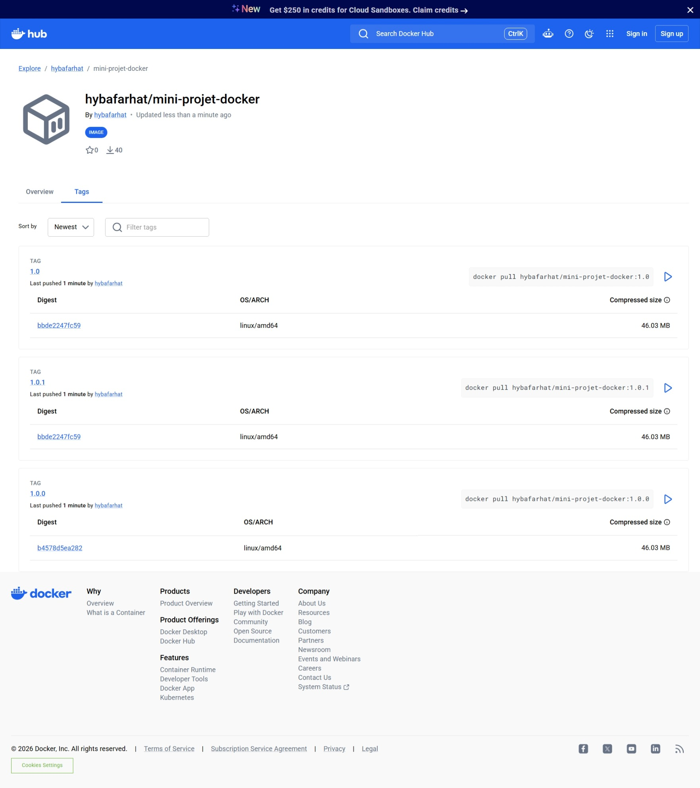

---

# Démarche suivie, étape par étape

## Étape 0 : Préparer le projet

Création du dossier de travail et du dépôt Git sur le serveur Ubuntu.

```bash
mkdir mini-projet-docker
cd mini-projet-docker
docker --version
git --version
git init
git branch -m main
```

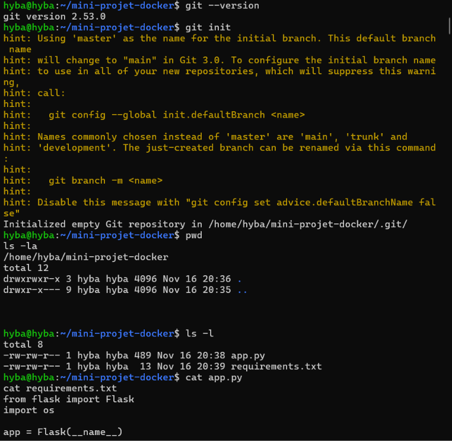

Le Dockerfile est versionné avec le code : il fait partie du projet, garde son historique et rend le build reproductible.

## Étape 1 : Écrire l'application configurable

`app.py` lit deux variables d'environnement avec `os.getenv`, chacune avec une valeur par défaut.

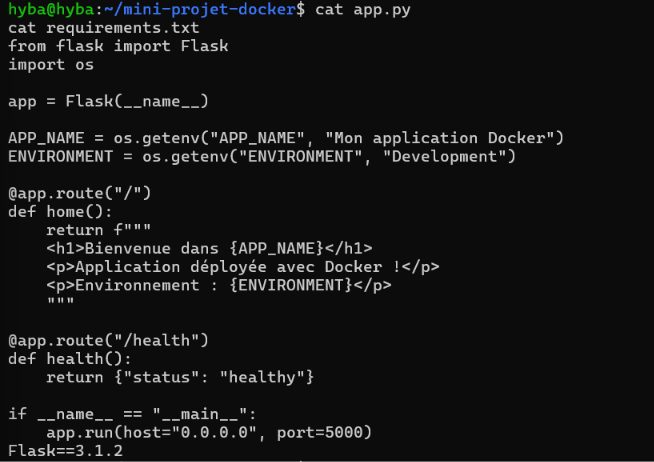

## Étape 2 : Écrire le Dockerfile et le .dockerignore

| Instruction | Rôle |
|---|---|
| `FROM python:3.12-slim` | Image de base légère |
| `WORKDIR /app` | Dossier de travail dans l'image |
| `COPY requirements.txt .` | Copie des dépendances seules (pour le cache) |
| `RUN pip install --no-cache-dir -r requirements.txt` | Installation des dépendances |
| `COPY app.py .` | Copie du code, en dernier |
| `ENV APP_NAME` / `ENV ENVIRONMENT` | Valeurs par défaut de la configuration |
| `EXPOSE 5000` | Documente le port de l'application |
| `CMD ["python", "app.py"]` | Commande lancée au démarrage |

`FROM`, `RUN` et `COPY` créent des couches de contenu ; `ENV`, `EXPOSE` et `CMD` n'ajoutent que des métadonnées. Le `.dockerignore` garde hors de l'image le dépôt `.git`, les caches Python et les fichiers de secrets.

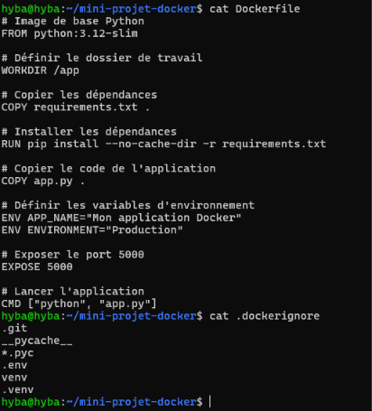

## Étape 3 : Construire, lancer et configurer

Construction de l'image avec un tag de version :

```bash
docker build -t mini-projet-docker:1.0 .
docker images
```

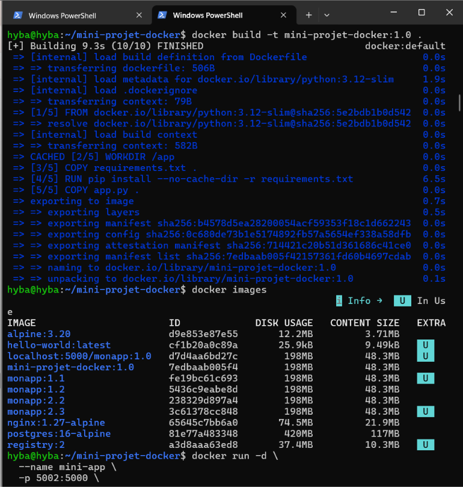

Lancement du conteneur `mini-app` avec un nom et un port publié, puis vérification avec `curl` et `docker logs` :

```bash
docker run -d --name mini-app -p 5002:5000 mini-projet-docker:1.0
curl http://localhost:5002
curl http://localhost:5002/health
docker logs mini-app
```

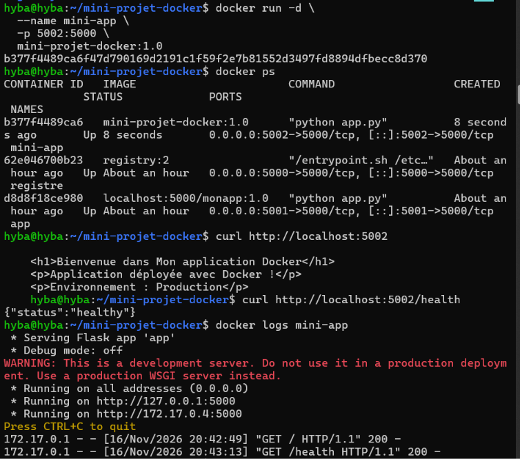

Le message change quand on modifie les variables, **sans reconstruire l'image** :

```bash
docker run -d --name mini-app-test -p 5003:5000 \
  -e APP_NAME="Mon Projet DevOps" -e ENVIRONMENT="Testing" \
  mini-projet-docker:1.0
```

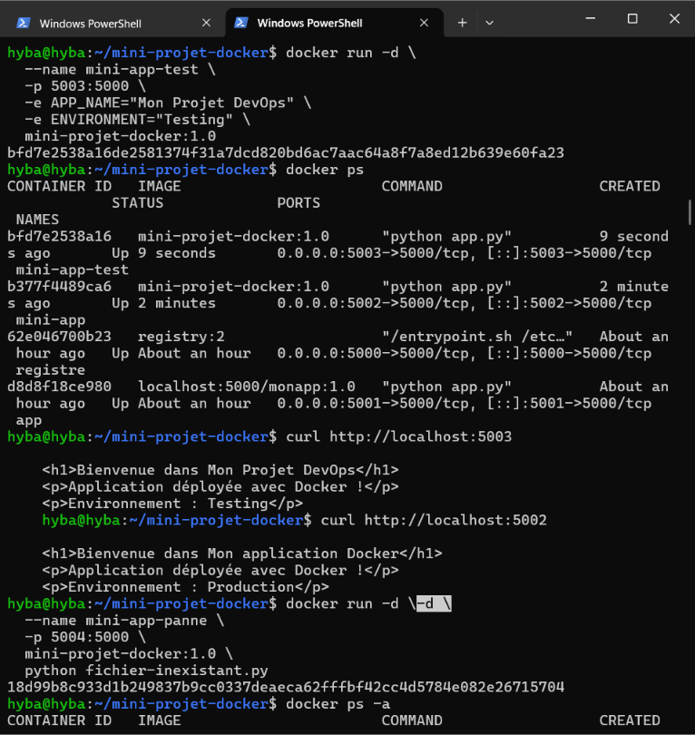

| Conteneur | Port | Page affichée |
|---|---|---|
| `mini-app` | 5002 | « Mon application Docker », Production |
| `mini-app-test` | 5003 | « Mon Projet DevOps », Testing |

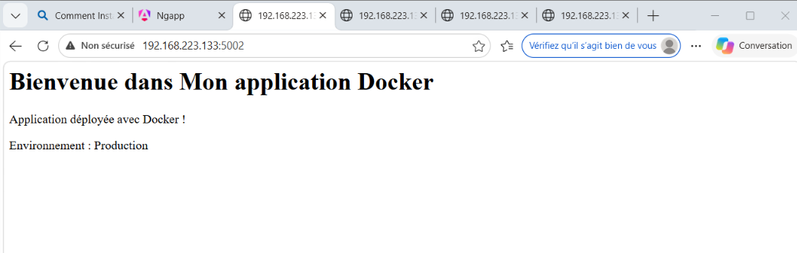
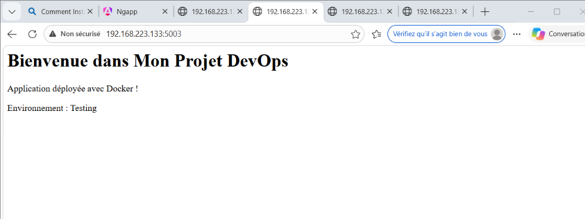
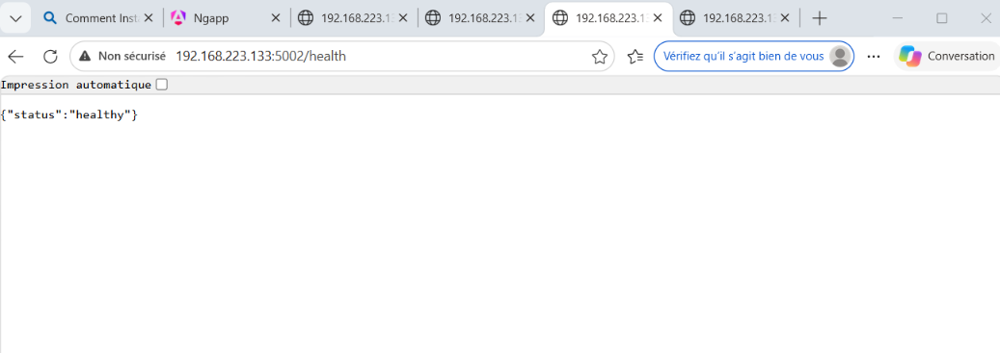

**Limites de ressources** : le conteneur `mini-app-limits` est lancé avec 128 Mo de mémoire et 0,5 CPU. Les limites sont vérifiées avec `docker inspect` et `docker stats` :

```bash
docker run -d --name mini-app-limits -p 5005:5000 --memory 128m --cpus 0.5 mini-projet-docker:1.0
docker inspect mini-app-limits --format='CPU: {{.HostConfig.NanoCpus}} | RAM: {{.HostConfig.Memory}}'
docker stats --no-stream mini-app-limits
```

Résultat : `CPU: 500000000 | RAM: 134217728` (0,5 CPU et 128 Mo), et `docker stats` affiche une limite de 128 MiB.

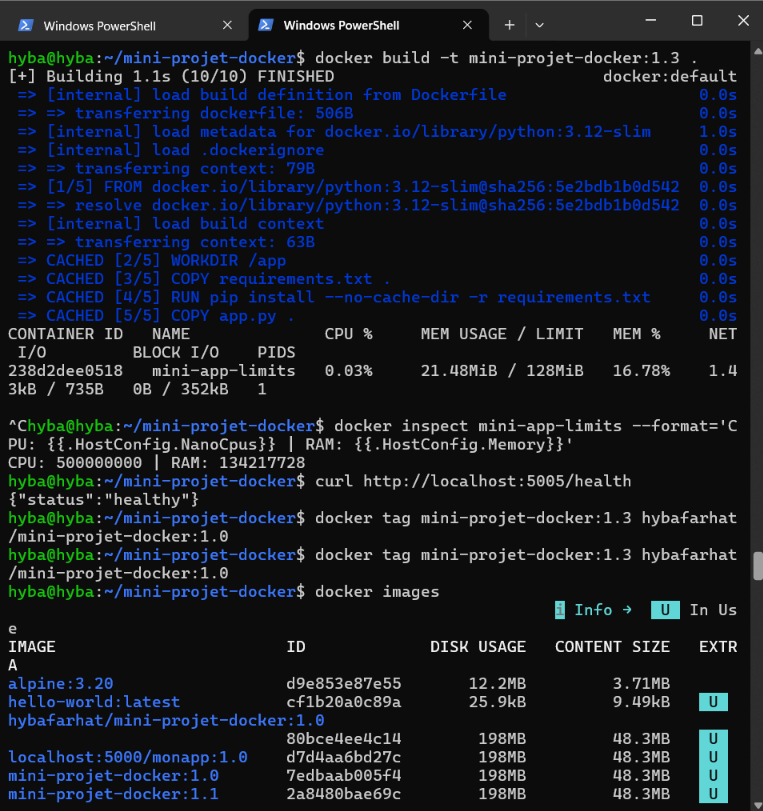
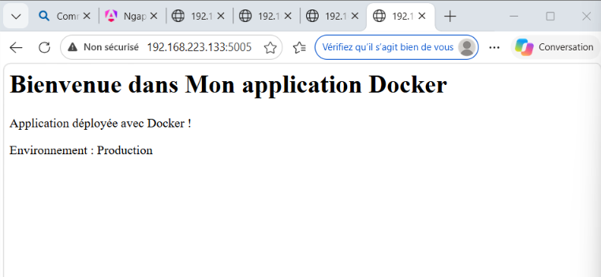

## Étape 4 : Panne et diagnostic

Une erreur est introduite dans la commande de lancement (fichier inexistant) :

```bash
docker run -d --name mini-app-panne -p 5004:5000 mini-projet-docker:1.0 python fichier-inexistant.py
```

Ordre d'investigation : `docker ps -a`, puis `docker logs`, puis `docker inspect`.

```bash
docker ps -a
docker logs mini-app-panne
docker inspect mini-app-panne --format '{{.State.ExitCode}} {{.Config.Cmd}}'
```

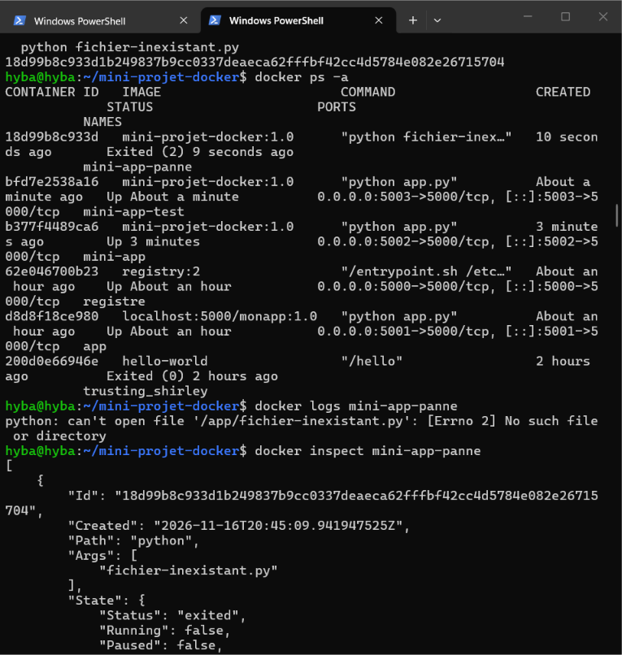

| Symptôme | Où le voir |
|---|---|
| Statut `Exited (2)` | `docker ps -a` |
| `can't open file '/app/fichier-inexistant.py'` | `docker logs` |
| `ExitCode 2` et `Cmd` erronée | `docker inspect` |

**Cause racine** : la commande de lancement désigne un fichier qui n'existe pas ; l'image est saine. **Correction** : supprimer le conteneur et le relancer sans la commande erronée.

```bash
docker rm mini-app-panne
docker run -d --name mini-app-panne -p 5004:5000 mini-projet-docker:1.0
curl http://localhost:5004/health
```

## Étape 5 : Observer le cache

Reconstruction de l'image sans changement : toutes les couches sont lues dans le cache (`CACHED`), le build passe de 9,3 s à 0,5 s.

```bash
time docker build -t mini-projet-docker:1.2 .
```

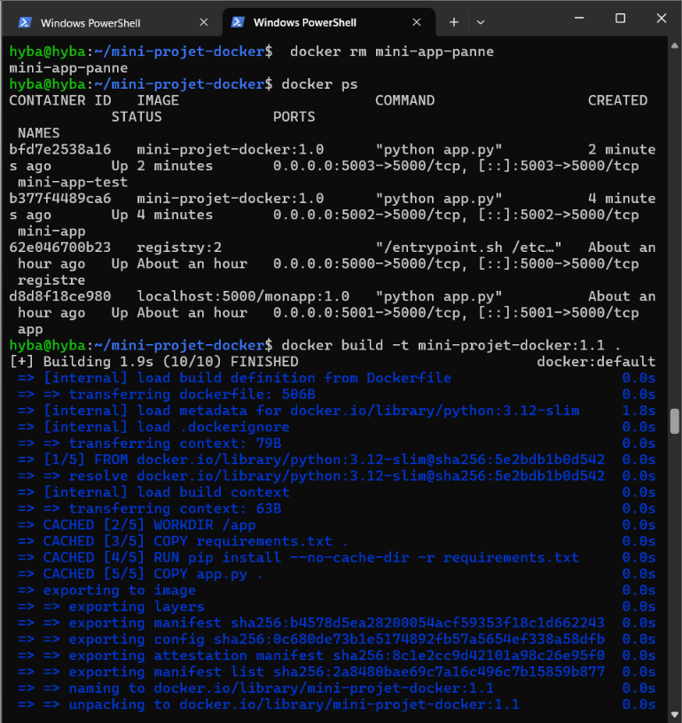
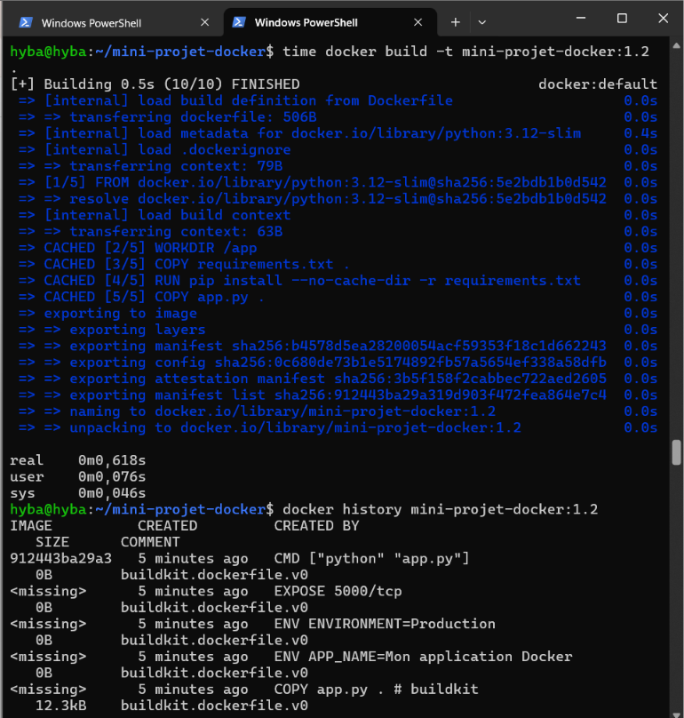

Observation des couches avec `docker history` :

```bash
docker history mini-projet-docker:1.2
```

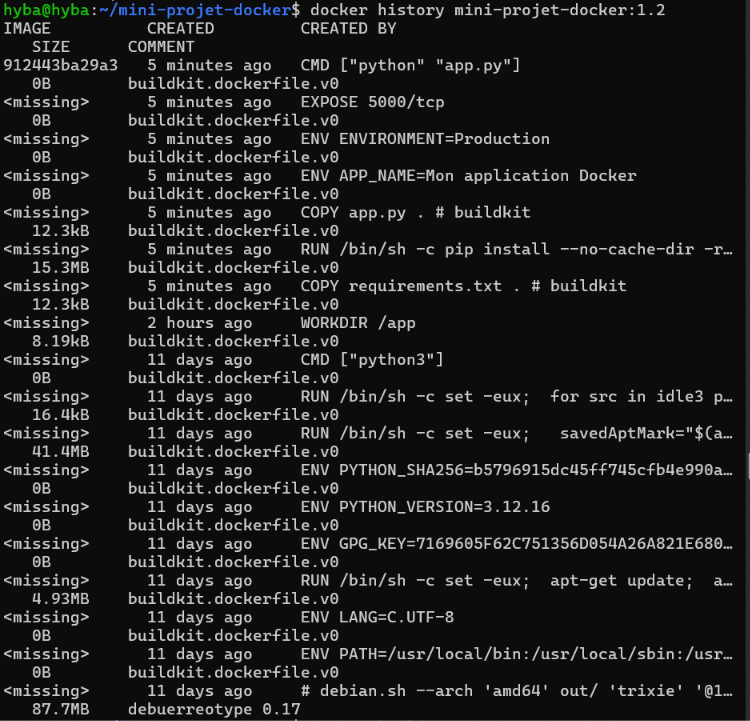

Après modification du code (`app.py`), seule la couche `COPY app.py` est exécutée de nouveau, grâce à l'ordre des instructions (dépendances installées avant la copie du code) :

```bash
echo "# modif" >> app.py
time docker build -t mini-projet-docker:1.4 .
```

| Étape du Dockerfile | Résultat après modification de `app.py` |
|---|---|
| `FROM`, `WORKDIR` | `CACHED` |
| `COPY requirements.txt .` | `CACHED` |
| `RUN pip install ...` | `CACHED` |
| `COPY app.py .` | exécutée de nouveau |

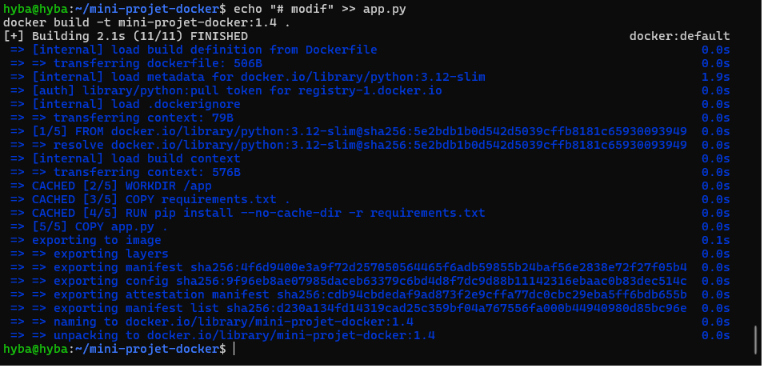

Si tout le code était copié avant l'installation des dépendances, chaque modification invaliderait le cache et `pip install` serait refait à chaque build.

## Étape 6 : Versionner et publier

Connexion à Docker Hub, puis publication de deux versions avec un alias :

```bash
docker login
docker tag mini-projet-docker:1.3 hybafarhat/mini-projet-docker:1.0.0
docker tag mini-projet-docker:1.3 hybafarhat/mini-projet-docker:1.0
docker push hybafarhat/mini-projet-docker:1.0.0
docker push hybafarhat/mini-projet-docker:1.0
```

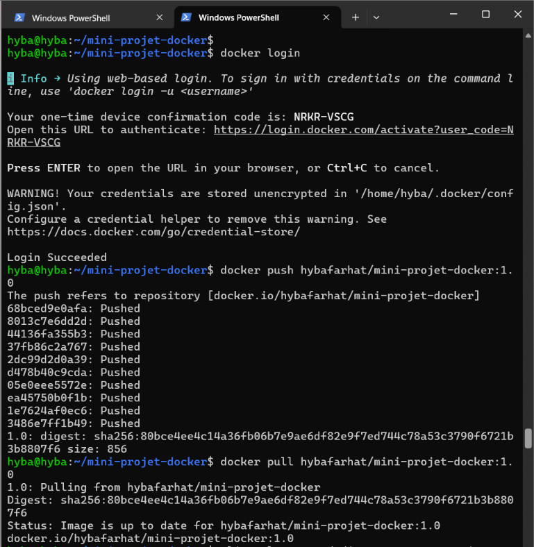

Après modification du code, publication de `1.0.1` et déplacement de l'alias `1.0` :

```bash
docker build -t mini-projet-docker:1.0.1 .
docker tag mini-projet-docker:1.0.1 hybafarhat/mini-projet-docker:1.0.1
docker tag mini-projet-docker:1.0.1 hybafarhat/mini-projet-docker:1.0
docker push hybafarhat/mini-projet-docker:1.0.1
docker push hybafarhat/mini-projet-docker:1.0
```

Sur Docker Hub, `1.0` et `1.0.1` ont le même digest ; `1.0.0` garde l'ancien (voir le tableau plus haut). Un tag de version précise déjà publié ne doit pas être réécrit : seul l'alias `1.0` se déplace.

## Étape 7 : Documenter

Ce `README.md` décrit l'application, la construction, le lancement complet (port, variables, limites), les variables avec leurs valeurs par défaut, le nom de l'image et ses versions. Les commandes de ce fichier suffisent à lancer l'image sans aide.

Publication sur GitHub :

```bash
git add .
git commit -m "Ajout du README"
git push
```

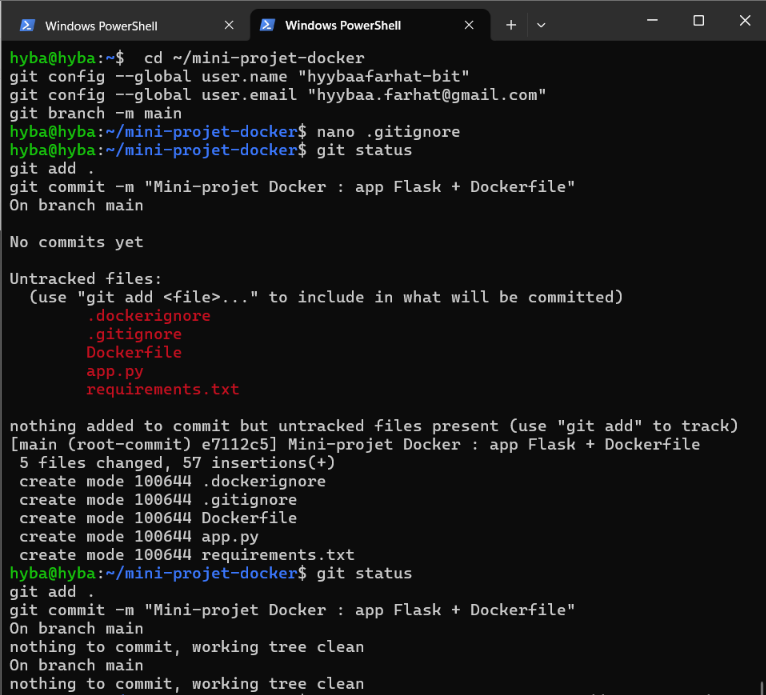
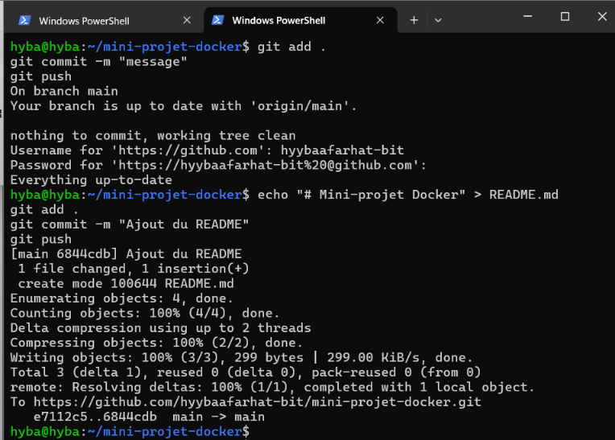

---

## Réponses aux questions de l'énoncé

- **Étape 0 : pourquoi versionner le Dockerfile avec le code ?** Le Dockerfile fait partie du projet : versionné avec le code, il garde l'historique des changements et rend le build reproductible avec un simple `git clone`.
- **Étape 1 : pourquoi une variable d'environnement plutôt que modifier l'image ?** La même image sert pour plusieurs environnements (Production, Testing) sans être reconstruite : seul le conteneur change.
- **Étape 2 : quelles instructions créent une couche ?** `FROM`, `RUN` et `COPY` créent des couches de contenu ; `ENV`, `EXPOSE` et `CMD` n'ajoutent que des métadonnées (0 B dans `docker history`).
- **Étape 3 : quelles limites et comment les vérifier ?** `--memory 128m` et `--cpus 0.5`, vérifiées avec `docker inspect` (134217728 octets et 500000000 NanoCpus) et `docker stats`.
- **Étape 4 : symptômes et cause racine ?** Statut `Exited (2)` et message `can't open file '/app/fichier-inexistant.py'`. La cause racine est la commande de lancement qui désigne un fichier inexistant ; l'image est saine.
- **Étape 5 : que se passerait-il si on copiait tout le code avant les dépendances ?** Chaque modification du code invaliderait la couche `COPY`, donc `pip install` serait refait à chaque build.
- **Étape 6 : pourquoi ne pas réécrire un tag de version précise ?** Un tag comme `1.0.0` doit toujours désigner la même image (même digest) pour garantir un résultat reproductible ; seul l'alias `1.0` se déplace.
- **Étape 7 : quelles informations manquaient dans le README ?** La première version ne précisait pas les limites de ressources, les variables avec leurs valeurs par défaut ni les versions de l'image.
